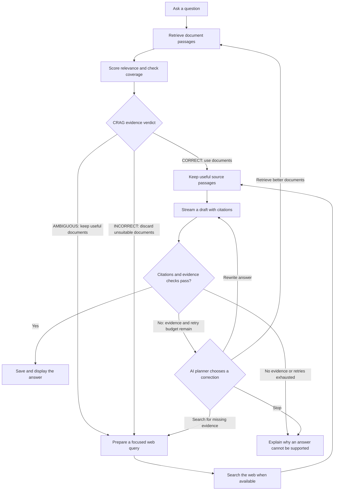
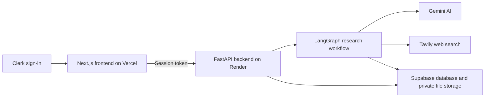

# Crebry — Agentic CRAG Research Workspace

Crebry helps you research uploaded documents and web sources. Ask a question, follow the research steps, and read an answer with citations you can inspect.

It uses **agentic Corrective Retrieval-Augmented Generation (CRAG)**: it finds evidence, checks whether that evidence answers your question, and chooses a correction when an answer needs more work.

## Why it is agentic CRAG

| Part | What it means in Crebry |
|---|---|
| Retrieval | Finds passages from your workspace that relate to your question. |
| Corrective RAG | Judges the evidence as correct, ambiguous, or incorrect, then uses it, adds web evidence, or replaces unsuitable results. |
| Agentic recovery | After an answer fails validation, an AI planner chooses whether to rewrite it, retrieve better documents, search the web, or stop. |
| Grounding | Checks citations and supporting evidence before accepting the answer. |

The planner chooses from available actions within retry and tool limits. Web research needs a configured Tavily key. If the evidence remains insufficient, Crebry explains the gap. These checks help keep answers supported by sources, but do not guarantee factual accuracy.

## Using Crebry

1. Sign in and create a workspace.
2. Upload PDF, DOCX, TXT, or Markdown files.
3. Choose an available Gemini model and ask a question.
4. Crebry checks your documents and searches the web when more evidence is needed and web search is configured.
5. Read the answer, open its citations, and ask follow-up questions. Conversations are saved in your workspace.

## How the project works

### When you upload a document

The backend checks that you own the workspace, extracts the text, and divides it into smaller passages. Scanned PDFs can use Gemini OCR to read text from images.

Gemini turns each passage into an embedding: a list of numbers used to find passages with similar meaning. In the hosted setup, Supabase stores these searchable passages, document details, and the original file.

### Research workflow



The workflow has five main stages:

1. **Find evidence.** Search the documents in your workspace for passages related to your question.
2. **Check the evidence.** Judge both relevance and whether the accepted passages cover the question.
3. **Fill gaps.** Keep useful documents and add web sources, or discard unsuitable documents and try web research.
4. **Write and check.** Use the selected source passages to produce a cited draft, then check its citations and factual support.
5. **Accept or correct.** Save an accepted answer. If a draft fails the checks, let the AI planner choose an allowed recovery action while budget remains.

| Verdict | What Crebry does |
|---|---|
| Correct | Uses strong, sufficiently complete document evidence. |
| Ambiguous | Keeps useful document evidence and looks for missing information on the web. |
| Incorrect | Removes untrustworthy document evidence and tries web sources instead. |

LangGraph connects these steps and follows the decisions returned by the evaluator and correction planner. Relevance and coverage usually share one Gemini call, which can also prepare a query for missing evidence. Separate coverage and query checks remain available when needed.

Refinement keeps original source sentences and their citation IDs. It is skipped when the evidence is already simple enough. Generation and answer validation remain separate steps.

### Understanding your answer

- **Document citations**, such as `[D1]`, point to passages in uploaded files.
- **Web citations**, such as `[W1]`, point to external sources found during research.
- **Streaming text** is a provisional draft until the checks finish.
- **The workflow panel** shows the research steps, evidence decisions, and corrective actions.
- **Saved conversations** let you return to your research and ask follow-up questions.

Click a citation to inspect its source. For example, if a report explains a topic but does not cover a recent change, Crebry can keep the useful report passages and look for the missing information on the web.

## How the services connect



The frontend sends requests through its Next.js API proxy. The backend verifies the Clerk session and workspace ownership before accessing data. Provider secrets stay on the server.

Research runs in a saved background job. The frontend receives progress events and draft text as they arrive. Reconnecting can recover saved progress; an interrupted step may run again.

## Technology stack

| Tool | Role |
|---|---|
| Next.js, React, TypeScript | Pages, chat, document library, and workflow display |
| FastAPI | Backend API and progress streaming |
| LangGraph | Agentic CRAG steps, evidence decisions, and correction paths |
| Gemini | Embeddings, evidence judgments, answer generation, and OCR |
| Tavily | Web search when document evidence needs help |
| Clerk | Sign-in and session verification |
| Supabase PostgreSQL and pgvector | Workspaces, conversations, research progress, and searchable passages |
| Supabase Storage | Private original documents |
| SQLite and Chroma | Local development alternatives |

## Run locally

You need **Python 3.12**, **Node.js 24**, npm, uv, and a Clerk application. Gemini is required for AI features. Tavily is optional for web search.

### Backend

From the repository root:

```powershell
cd backend
uv sync --frozen
```

Create `backend/.env` with these local settings and your own credentials:

```dotenv
ENVIRONMENT=development
GEMINI_API_KEY=your_gemini_key
TAVILY_API_KEY=your_tavily_key
EMBEDDING_PROVIDER=gemini
VECTOR_PROVIDER=chroma
STORAGE_PROVIDER=auto
DATA_DIR=data
CLERK_SECRET_KEY=your_clerk_secret_key
CLERK_ISSUER=https://your-clerk-instance-domain
FRONTEND_ORIGIN=http://localhost:3000
CLERK_AUTHORIZED_PARTIES=http://localhost:3000,http://127.0.0.1:3000
```

Leave `DATABASE_URL` unset to use SQLite. The checked-in `backend/.env.example` describes hosted Supabase settings, so use the settings above for local development.

Start the backend:

```powershell
uv run uvicorn app.main:app --host 127.0.0.1 --port 8000
```

### Frontend

In another terminal, from the repository root:

```powershell
cd frontend
npm ci
```

Create `frontend/.env.local` using the same Clerk application as the backend:

```dotenv
NEXT_PUBLIC_CLERK_PUBLISHABLE_KEY=your_clerk_publishable_key
CLERK_SECRET_KEY=your_clerk_secret_key
BACKEND_API_URL=http://127.0.0.1:8000/api
```

Start the frontend:

```powershell
npm run dev
```

Open [localhost:3000](http://localhost:3000), sign in, and upload [the sample document](examples/research-notes.md). Restart the relevant service after changing its environment variables.

## Hosted setup

| Service | Configuration |
|---|---|
| Vercel | Frontend root: `frontend`. Set Clerk variables and `BACKEND_API_URL` to your Render backend URL ending in `/api`. |
| Render | Backend root: `backend`. Use `Dockerfile`, build context `.`, and health endpoint `/api/health`. |
| Supabase | Run `backend/supabase/setup.sql`, then configure the PostgreSQL Session pooler and private Storage bucket. |

Follow the [Supabase deployment guide](docs/supabase-deployment.md) for the complete environment settings. Keep database passwords and backend API keys out of Git and frontend public variables.

Supabase stores hosted user data; Render's temporary filesystem is only scratch space. Changing storage providers does not move existing data.

### Free hosting and paused projects

Supabase Free is a free plan with usage limits, not a one-month trial. Projects with low database activity over a week can pause. See [Supabase's pause policy](https://supabase.com/docs/guides/platform/free-project-pausing).

If the project pauses, resume it in Supabase, wait until it is active, and redeploy the backend on Render if it has not recovered. Check `/api/health` before using the app again. Render Free can also sleep when idle, so the first request may take longer.

Gemini and Tavily have separate quotas. The app selects eligible free-tier Gemini models, but your Google project's billing settings still determine charges. Use a project with billing disabled when you need free-only use.

## Where to read the code

| Path | What it does |
|---|---|
| `backend/app/api/routes.py` | Receives requests and checks workspace access |
| `backend/app/agents/graph.py` | Decides which research step runs next |
| `backend/app/agents/nodes.py` | Implements retrieval, grading, search, generation, and validation |
| `backend/app/agents/state.py` | Defines data passed between research steps |
| `backend/app/services/ai.py` | Calls Gemini and Tavily |
| `backend/app/services/routing.py` | Selects models and handles fallback |
| `backend/app/services/jobs.py` | Saves jobs, checkpoints, and progress events |
| `backend/app/services/documents.py` | Extracts and prepares document text |
| `frontend/lib/research-stream.ts` | Sends questions and receives progress |
| `frontend/stores/research.ts` | Holds the current workspace and chat state |
| `frontend/components/` | Displays chat, documents, citations, and the workflow |
